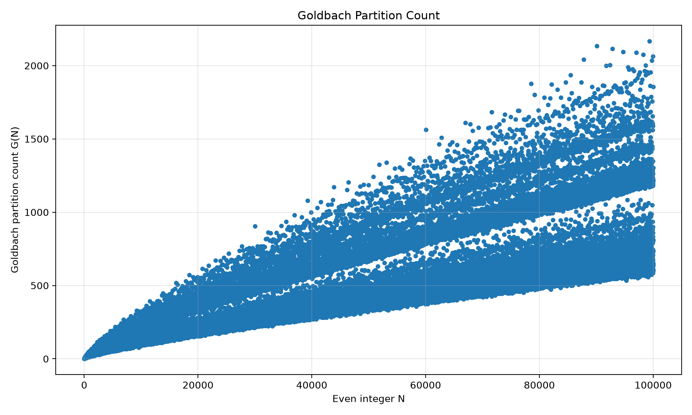
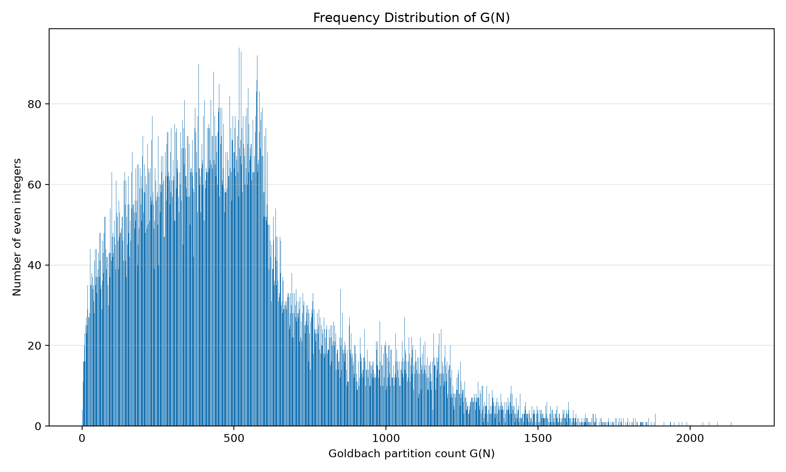
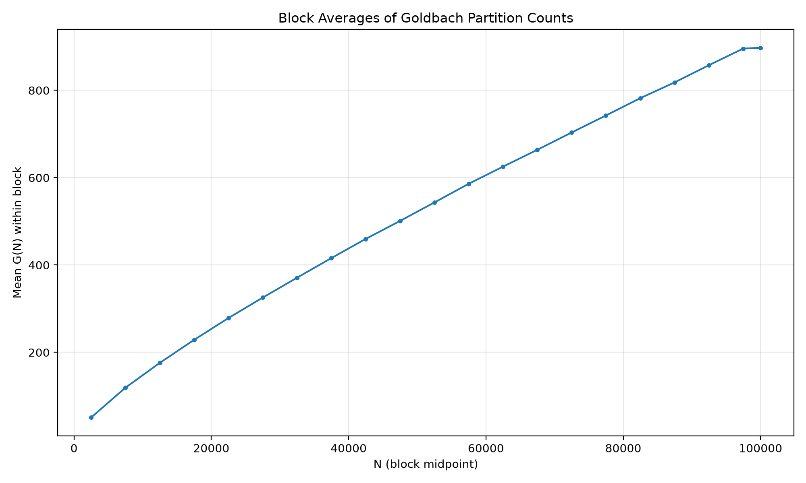

# Goldbach Lab

### A Computational Laboratory for Goldbach's Conjecture

Goldbach Lab is a computational mathematics project that investigates Goldbach partitions through C programming, Python-based statistical analysis, data visualization, and independent computational verification.

The project explores a simple question:

**For each even integer \(N \geq 4\), how many unordered pairs of primes sum to \(N\)?**

The goal is not to prove Goldbach's conjecture, but to build a reproducible computational experiment and learn how to analyze mathematical data responsibly.

---

## Table of Contents

- [Mathematical Background](#mathematical-background)
- [Project Goals](#project-goals)
- [Project Structure](#project-structure)
- [Methods](#methods)
- [Visualizations](#visualizations)
- [Current Experimental Results](#current-experimental-results)
- [Reproducibility](#reproducibility)
- [Limitations](#limitations)
- [Future Work](#future-work)

---

## Mathematical Background

Goldbach's conjecture states that every even integer greater than 2 can be expressed as the sum of two primes.

For an even integer \(N \geq 4\), define

\[
G(N)=\#\{(p,q):p+q=N,\ p\leq q,\ p,q\text{ prime}\}.
\]

Here, \(G(N)\) denotes the number of **unordered Goldbach partitions** of \(N\). The condition \(p \leq q\) ensures that each pair is counted only once.

For example:

- \(G(4)=1\), since \(4=2+2\).
- \(G(6)=1\), since \(6=3+3\).
- \(G(8)=1\), since \(8=3+5\).
- \(G(10)=2\), since \(10=3+7=5+5\).

Goldbach's conjecture is equivalent to the assertion that

\[
G(N)\geq 1
\]

for every even integer \(N\geq4\).

---

## Project Goals

Goldbach Lab aims to:

1. **Compute:** Implement a C program to count Goldbach partitions over a finite range of even integers.
2. **Store:** Export computational results to CSV for transparent data handling.
3. **Analyze:** Use Python to calculate descriptive statistics and visualize the results.
4. **Verify:** Independently recompute the partition counts using a separate Python implementation.
5. **Document:** Record the experimental methods, results, limitations, and reproducibility instructions.

The project is also an exercise in scientific computing: separating computation from analysis, checking outputs, and distinguishing empirical observations from mathematical proof.

---

## Project Structure

```text
Goldbach-Lab/
├── goldbach.c
├── analyze.py
├── goldbach_results.csv
├── results/
│   ├── goldbach_scatter.png
│   ├── goldbach_frequency.png
│   ├── goldbach_block_means.png
│   ├── verification.csv
│   └── report.txt
└── README.md
```

### Main Files

- `goldbach.c` — C implementation for computing Goldbach partition counts.
- `goldbach_results.csv` — Raw computational results, with columns `N` and `G`.
- `analyze.py` — Python analysis, validation, visualization, and verification script.
- `results/verification.csv` — Row-by-row comparison of the C and Python counts.
- `results/report.txt` — Summary statistics and validation results.
- `results/goldbach_scatter.png` — Scatter plot of Goldbach partition counts.
- `results/goldbach_frequency.png` — Frequency distribution of partition counts.
- `results/goldbach_block_means.png` — Mean partition counts across consecutive blocks.

---

## Methods

### 1. C Computation

The C program computes \(G(N)\) for even integers in the selected range and writes the results to `goldbach_results.csv`.

The CSV file uses the following format:

```csv
N,G
4,1
6,1
8,1
10,2
12,1
```

These rows illustrate the file format and initial values, rather than the complete dataset.

### 2. Data Validation

The Python analysis checks basic properties of the dataset, including:

- Every \(N\) is even and at least 4.
- Every recorded partition count is positive.
- Values of \(N\) are ordered and contain no duplicates.
- The tested range contains the expected sequence of even integers.

These checks help detect malformed or incomplete data.

### 3. Independent Computational Verification

The Python script independently counts Goldbach partitions using a Sieve of Eratosthenes to identify primes, then compares its counts with the values produced by the C program.

The comparison is recorded in `results/verification.csv`.

Independent implementations provide a useful cross-check, although they cannot rule out every possible shared conceptual error.

### 4. Statistical Analysis

The analysis script calculates descriptive statistics, including:

- Number of observations
- Mean and median of \(G(N)\)
- Minimum and maximum partition counts
- Values of \(N\) attaining the reported minimum and maximum

It also generates plots to explore the variation and frequency of Goldbach partition counts.

---

## Visualizations

The following figures summarize the computational experiment over the tested range.

### 1. Goldbach Partition Count

Each point represents the number of unordered prime-pair decompositions \(G(N)\) for an even integer \(N\).



### 2. Frequency Distribution

This chart shows how frequently each observed value of \(G(N)\) occurs in the dataset.



### 3. Block Averages

This plot shows the mean value of \(G(N)\) across consecutive blocks of even integers. Block averages help summarize local variation without displaying every observation individually.



---

## Current Experimental Results

The current dataset contains the following reported results:

| Metric | Result |
|---|---:|
| Number of observations | 49,999 |
| Range of \(N\) | 4 to 100,000 |
| Mean of \(G(N)\) | 507.3498 |
| Median of \(G(N)\) | 456 |
| Minimum of \(G(N)\) | 1 |
| Values attaining the minimum | 4, 6, 8, 12 |
| Maximum of \(G(N)\) | 2,168 |
| Value attaining the maximum | 99,330 |
| Matching C/Python rows | 49,999 / 49,999 |

The validation report also recorded no basic consistency errors.

These values summarize a finite computational dataset. They do not establish a theorem about all even integers.

---

## Reproducibility

### Requirements

- A C compiler, such as GCC
- Python 3
- Matplotlib

Install Matplotlib if it is not already available:

```bash
python3 -m pip install matplotlib
```

### Step 1: Compile the C Program

Run the following command from the project root:

```bash
gcc goldbach.c -o goldbach
```

### Step 2: Generate the Dataset

Run the compiled program:

```bash
./goldbach
```

The program should generate `goldbach_results.csv` in its configured output location.

### Step 3: Analyze and Verify the Results

Run:

```bash
python3 analyze.py
```

The script should validate the dataset, calculate summary statistics, compare the C and Python results, and generate the report and figures under `results/`.

### Important Notes

- Run the commands from the project root unless your code specifies otherwise.
- The C program must write `goldbach_results.csv` to the location expected by `analyze.py`.
- The `results/` directory must exist or be created by the Python script.
- The reported results correspond to the dataset used for the current experiment. Regenerating the dataset may change the reported statistics if the implementation or experimental range changes.

---

## Limitations

This project has several important limitations.

1. **Finite range:** The experiment covers even integers from 4 through 100,000. It cannot establish the conjecture for all even integers.
2. **Computational evidence is not proof:** Finding Goldbach partitions for every tested value does not prove Goldbach's conjecture.
3. **Implementation risk:** Two programs can share a conceptual error, so agreement alone does not guarantee correctness.
4. **Descriptive statistics:** Means, medians, and plots describe the observed dataset. They do not establish an asymptotic law or explain the underlying number-theoretic behavior.
5. **Scope of verification:** The current checks establish agreement and basic consistency over the tested dataset, not formal verification of either implementation.

The appropriate conclusion is that the computation provides reproducible finite-range evidence, not a proof of Goldbach's conjecture.

---

## Future Work

Potential extensions include:

- Improving computational efficiency for larger ranges.
- Adding unit tests for prime generation and partition counting.
- Comparing alternative algorithms for computing \(G(N)\).
- Studying how the distribution of \(G(N)\) changes with \(N\).
- Comparing empirical patterns with clearly stated theoretical predictions.
- Recording compiler versions, execution environments, and experiment parameters for stronger reproducibility.
- Adding automated tests that run whenever the source code changes.

Any proposed pattern should be tested against independent computations and relevant mathematical literature before being presented as a new result.

---

## Scope

Goldbach Lab is an educational and exploratory computational mathematics project. Its emphasis is on transparent computation, independent checking, data visualization, and careful mathematical interpretation.

**The central principle is simple: computational evidence can guide mathematical questions, but it must not be confused with a mathematical proof.**
